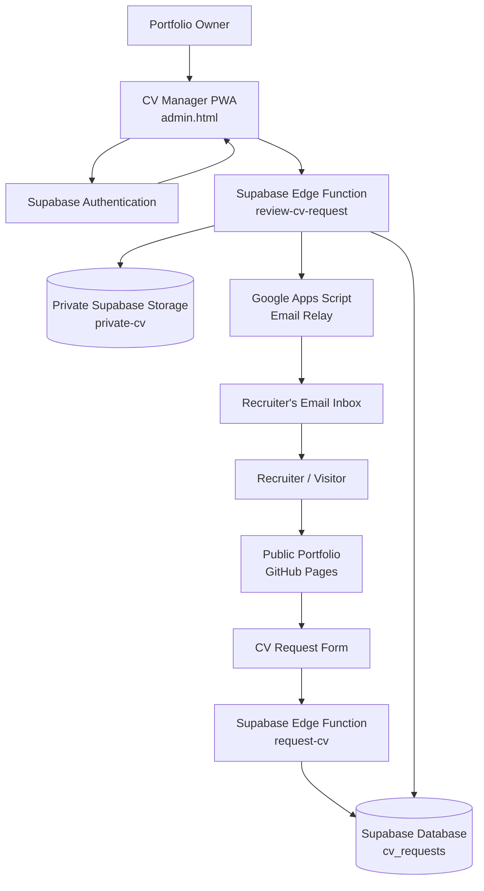
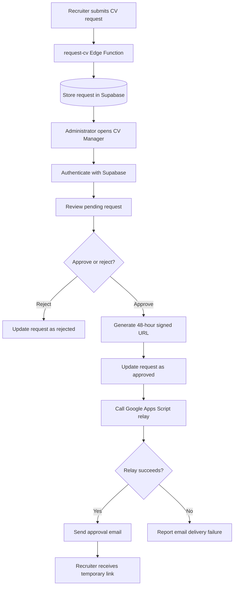

# CV Manager — Secure CV Request & Approval System

A privacy-conscious CV distribution system built with **GitHub Pages, Supabase, Google Apps Script, and a Progressive Web App (PWA)**.

Instead of publishing a CV as a permanently accessible PDF, this project introduces a controlled request-and-approval workflow. Recruiters can request access to a CV, the owner reviews each request through a private dashboard, and approved recruiters receive a time-limited download link by email.

The administrative dashboard is also installable on Android as **CV Manager**, using Progressive Web App capabilities.

---

## Table of Contents

- [1. Project Overview](#1-project-overview)
- [2. Architecture](#2-architecture)
- [3. Technology Stack](#3-technology-stack)
- [4. Request Lifecycle](#4-request-lifecycle)
- [5. Security Architecture](#5-security-architecture)
- [6. Supabase Implementation](#6-supabase-implementation)
- [7. Google Apps Script Email Relay](#7-google-apps-script-email-relay)
- [8. Administrator Dashboard](#8-administrator-dashboard)
- [9. CV Manager PWA](#9-cv-manager-pwa)
- [10. Repository Structure](#10-repository-structure)
- [11. Deployment Guide](#11-deployment-guide)
- [12. Configuration and Secrets](#12-configuration-and-secrets)
- [13. Testing and Verification](#13-testing-and-verification)
- [14. Security Considerations and Limitations](#14-security-considerations-and-limitations)
- [15. Future Improvements](#15-future-improvements)
- [16. Contributing](#16-contributing)

---

## 1. Project Overview

### The problem

Publishing a CV directly on a personal portfolio creates a permanent public download URL.

This has several disadvantages:

- Anyone can download the CV without the owner's knowledge.
- There is no approval workflow.
- The owner cannot easily track incoming CV requests.
- Publicly shared file URLs can remain accessible indefinitely.
- There is no controlled expiration mechanism.

### The solution

CV Manager introduces a request-based access system.

A recruiter submits a CV request through the public portfolio. The request is stored in Supabase and becomes visible in a private administrator dashboard.

The owner can approve or reject the request.

When approved, the system generates a temporary signed URL for the private CV and sends it to the recruiter's email address through a Google Apps Script relay.

The signed URL expires after **48 hours**.

### Key features

- Public CV request form.
- Centralized request management.
- Private CV storage.
- Authenticated administrator dashboard.
- Approval and rejection workflow.
- Temporary, 48-hour signed download URLs.
- Email delivery through Google Apps Script.
- Protected server-side secrets.
- Android-installable PWA dashboard.
- Network-only service worker strategy to avoid caching sensitive dashboard information.

---

## 2. Architecture

### High-level architecture diagram

The system separates the public portfolio, private administrative workflow, file storage, and email delivery.



### Component responsibilities

| Component | Responsibility |
|---|---|
| GitHub Pages | Hosts the public portfolio and administrator frontend |
| Request form | Collects CV access requests |
| Supabase Edge Functions | Executes trusted server-side request and approval operations |
| Supabase Database | Stores requests and their review state |
| Supabase Authentication | Authenticates the administrator |
| Supabase Storage | Stores the CV in a private bucket |
| Google Apps Script | Relays approval emails |
| CV Manager PWA | Provides an installable administrative interface |

### Architectural principle

The frontend is not trusted with privileged operations.

The browser can request an operation, but the server-side functions validate permissions and perform sensitive actions.

---

## 3. Technology Stack

| Technology | Usage |
|---|---|
| HTML, CSS, JavaScript | Portfolio and dashboard frontend |
| GitHub Pages | Static website hosting |
| Supabase | Database, Authentication, Storage and Edge Functions |
| Supabase Storage | Private PDF storage |
| Supabase Edge Functions | Server-side business logic |
| Google Apps Script | Email relay |
| Web App Manifest | PWA installation metadata |
| Service Worker | PWA lifecycle and network-only request handling |
| Chrome on Android | PWA installation and execution |

The project does not require a continuously running application server.

GitHub Pages handles static hosting, while Supabase provides the backend services.

---

## 4. Request Lifecycle

### Step 1: Recruiter submits a request

The recruiter visits the portfolio and submits the CV request form.

The form sends the request to the Supabase Edge Function:

`request-cv`

The browser does not receive a public CV download URL.

### Step 2: Request is stored

The Edge Function validates the incoming request and creates a record in:

`public.cv_requests`

The request becomes available for administrative review.

### Step 3: Administrator reviews the request

The owner opens the private CV Manager dashboard and authenticates using Supabase Authentication.

The dashboard retrieves the available requests and displays their review status.

The owner can:

- Approve a pending request.
- Reject a pending request.
- Review previously processed requests.

### Step 4: Approval is processed server-side

The dashboard invokes:

`review-cv-request`

The function:

1. Requires an authenticated user.
2. Checks that the user's `app_metadata.role` is `admin`.
3. Validates the request ID and requested status.
4. Retrieves the pending request.
5. Prevents an already-reviewed request from being processed again.
6. Generates a signed URL for the private CV.
7. Sets the URL expiration to 48 hours.
8. Updates the request's review status and timestamps.
9. Calls the configured email relay.

The function returns the result to the dashboard.

If email delivery fails, the request can remain approved while the response reports `email_sent: false`. This separates the approval decision from the email delivery outcome.

### Step 5: Temporary CV URL is generated

The function generates a signed URL from the private Supabase Storage bucket:

`private-cv`

The stored document is:

`SumanMandal-CV.pdf`

The generated link is valid for 48 hours.

A signed URL is a bearer link: anyone possessing it may be able to access the document until it expires. It should therefore be treated as confidential.

### Step 6: Email is delivered

The Edge Function sends the email relay a payload containing:

```json
{
  "secret": "<RELAY_SECRET>",
  "to": "<RECRUITER_EMAIL>",
  "name": "<RECRUITER_NAME>",
  "cv_url": "<SIGNED_CV_URL>",
  "expires_at": "<EXPIRATION_TIMESTAMP>"
}
```

Google Apps Script validates the shared secret and sends the approval email.

The recruiter receives the temporary CV link.

### Request lifecycle diagram



---

## 5. Security Architecture

Security is the central design consideration of this project.

The CV is not stored in the public GitHub repository. The public website only provides the request interface.

### 5.1 Private file storage

The CV is stored in a Supabase Storage bucket named:

`private-cv`

The bucket is private rather than publicly accessible.

The application does not publish a permanent public file URL.

Access is provided through a temporary signed URL generated after an approval decision.

### 5.2 Server-side approval enforcement

Approval is not trusted merely because a browser sends an approval request.

The `review-cv-request` Edge Function performs the authorization check.

The function requires:

- A valid authenticated Supabase user.
- An administrator role in `app_metadata`.
- A valid request ID.
- A valid requested review status.
- A request that has not already been reviewed.

The administrator role should be assigned through a trusted administrative process. It should not be editable by an ordinary user through client-side profile updates.

### 5.3 Separation of public and privileged credentials

The browser may contain the Supabase publishable key required for normal frontend operations.

It must never contain:

- Supabase service-role keys.
- Google Apps Script relay secrets.
- Private API credentials.
- Administrative signing credentials.

Privileged operations belong in server-side Edge Functions.

### 5.4 Google Apps Script relay authentication

The email relay uses a shared secret.

Two values must match:

| Location | Secret name |
|---|---|
| Supabase Edge Function environment | `CV_EMAIL_RELAY_SECRET` |
| Google Apps Script Script Properties | `RELAY_SECRET` |

The Edge Function sends the secret in the relay payload.

Google Apps Script checks the supplied value against its Script Properties before sending an email.

The relay URL is configured through:

`CV_EMAIL_RELAY_URL`

Neither the relay secret nor the Apps Script configuration should be committed to GitHub.

### 5.5 Temporary signed URLs

The signed CV URL expires after 48 hours.

This reduces the lifetime of an exposed download link, but it does not make a downloaded PDF revocable.

Once a recruiter downloads the document, the system cannot remotely delete that copy.

### 5.6 Privacy-conscious PWA caching

The service worker does not cache dashboard responses, recruiter records, signed CV URLs, or other application data.

It uses network-only handling for same-origin GET requests.

This avoids creating an additional persistent browser cache of sensitive dashboard responses.

The trade-off is that CV Manager requires an internet connection.

---

## 6. Supabase Implementation

Supabase provides the backend infrastructure.

### Services used

- Database: `cv_requests`
- Authentication: administrator login
- Storage: private CV bucket
- Edge Functions: request and approval operations

### Database

The request records are stored in:

`public.cv_requests`

The review workflow uses request statuses, including pending, approved, and rejected.

The approval implementation also maintains review-related timestamps, including:

- `reviewed_at`
- `access_expires_at`

Row Level Security is enabled on the request table.

The exact policies and database schema should be preserved from the deployed project when reproducing the implementation. Do not replace them with broad public read or write policies.

### Edge Functions

#### `request-cv`

Responsible for accepting and validating public CV requests and creating request records.

#### `review-cv-request`

Responsible for authenticated administrative review, authorization, signed URL creation, request status updates, and email relay invocation.

### Signed URL generation

The approval function generates a signed URL from the private Storage bucket with a 48-hour lifetime.

Conceptually:

```javascript
const { data, error } = await supabase.storage
  .from("private-cv")
  .createSignedUrl(
    "SumanMandal-CV.pdf",
    48 * 60 * 60
  );
```

The actual function must also handle errors and must use a server-side Supabase client with the necessary privileges.

---

## 7. Google Apps Script Email Relay

Google Apps Script is used as a lightweight email delivery service.

This avoids exposing email-sending credentials in the public frontend.

### Why Google Apps Script?

- No separate email server is required.
- It can send messages through a Google account.
- Script Properties can hold the relay secret.
- The relay can be invoked over HTTP.
- It keeps email delivery separate from the dashboard frontend.

### Relay configuration

The Edge Function uses:

- `CV_EMAIL_RELAY_URL`
- `CV_EMAIL_RELAY_SECRET`

Google Apps Script stores the matching secret in:

- `RELAY_SECRET`

The script should validate the incoming secret before processing the email request.

### Relay request

The Edge Function sends the recipient's name and email, the signed CV URL, and its expiration timestamp.

The relay uses these values to construct the approval email.

### Important security rules

1. Never place the relay secret in `admin.html`, `index.html`, or `script.js`.
2. Never commit Script Properties or secret values to GitHub.
3. Never use the Supabase service-role key as the relay secret.
4. Validate the shared secret before sending an email.
5. Do not log the full signed URL or relay secret.
6. Return a clear failure response if email delivery cannot be completed.

The relay secret authenticates requests to the relay; it does not replace the administrator authorization check performed by the Edge Function.

---

## 8. Administrator Dashboard

The administrative dashboard is implemented in:

`admin.html`

It is hosted through GitHub Pages and communicates with Supabase.

### Dashboard responsibilities

- Authenticate the administrator.
- Retrieve CV access requests.
- Display request information and status.
- Submit approval or rejection decisions.
- Display the result of the review operation.
- Report email delivery failures separately from approval status.

### Administrative authorization

The dashboard login
